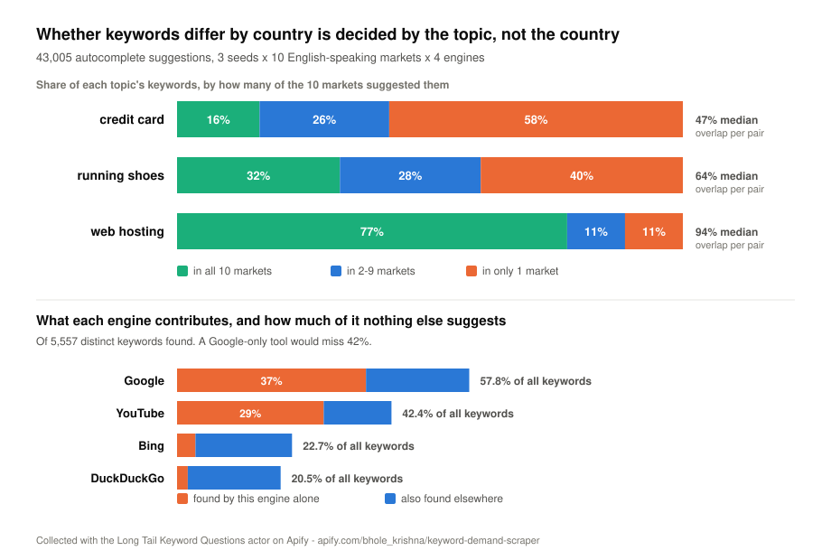

# What 10 English-speaking markets autocomplete

**43,005 search suggestions. 3 topics. 10 markets that all search in English. 4 engines. One day.**

Every keyword tool offers country targeting. Almost none of them tell you whether it is worth
using. So this dataset was collected to answer one question with numbers: **if you run the same
seed in ten different countries, how different are the results?**

The answer turned out to be: *it depends entirely on the topic* — and the difference is large
enough to change how you plan content.

<picture>
  <source media="(prefers-color-scheme: dark)" srcset="chart-dark.svg">
  
</picture>

## The finding

| Topic | Median overlap between any two markets | Keywords in **all 10** markets | Keywords in **only one** market |
|---|---|---|---|
| `credit card` | **46.9%** | 16.3% | **58.1%** |
| `running shoes` | 64.5% | 32.2% | 40.0% |
| `web hosting` | **93.7%** | 77.1% | 11.4% |

Credit cards are issued by local banks under local rules, so most of the demand is local: **58% of
the credit-card keywords appeared in exactly one of the ten markets.** Web hosting is a global
digital product bought the same way everywhere, and the ten markets returned **93.7% the same
list** — country targeting on that topic is effort spent for nothing.

So "should I do country-specific keyword research?" has a real answer, and it is a property of
your category, not of your tool. You can measure it for your own category in one run.

### What market-exclusive keywords actually look like

These are real rows from `keyword_market_matrix.csv`, each suggested in exactly one market:

| Market | `credit card` | `running shoes` |
|---|---|---|
| **IN** | `credit card meaning in marathi` | `which running shoes is best for men` |
| **ZA** | `credit card capitec` | `running shoes edgars` |
| **SG** | `credit card citibank waiver` | `running shoes jewel` |
| **PH** | `credit card convert to cash` | `running shoes ukay` |
| **AE** | `credit card cash withdrawal malayalam` | `running shoes abu dhabi` |
| **NG** | `credit card checkout ui figma` | `running shoes lagos` |

Local banks (`capitec`, `citibank`), local retailers (`edgars`, `ukay`, `shopee`), local languages
(`marathi`, `malayalam`), local cities (`abu dhabi`, `lagos`). No keyword tool's US-centric
database contains these, because they are not US demand.

One more thing worth noticing: **the UK was the exception.** Only 10 of the 3,099 `credit card`
keywords and a single one of the 1,584 `running shoes` keywords were exclusive to GB. British and American search
language for these topics is nearly the same list; Indian, Filipino and Emirati search language
is not.

## The second finding: one engine is not enough

| Engine | Share of all 5,557 keywords it found | Of its own finds, share nothing else suggested |
|---|---|---|
| **Google** | 57.8% | 64.7% |
| **YouTube** | 42.4% | **68.4%** |
| **Bing** | 22.7% | 16.0% |
| **DuckDuckGo** | 20.5% | 10.4% |

**A Google-only keyword tool misses 42.2% of what people type.** YouTube's suggestion box is close
to a separate corpus: more than two thirds of what it offers, no other engine does. That is people
phrasing a search because they want to *watch* something rather than read it.

Bing and DuckDuckGo add less that is unique (16.0% and 10.4%), which is itself useful to know —
they are worth including, but they are not where the surprises live.

---

## Files

### `data/suggestions.csv` — every suggestion as collected (43,005 rows)

The raw record. One row per suggestion per query per engine per market.

| Column | Description |
|---|---|
| `seed` | One of the three seed terms |
| `market` | Two-letter country code sent to the engine |
| `engine` | `google`, `youtube`, `bing` or `duckduckgo` |
| `query` | The exact expansion query sent (the seed, seed + a letter, or a question word + seed) |
| `rank_in_suggestions` | Position in that engine's suggestion list, 1 = first |
| `keyword` | The suggested phrase, lowercased |
| `intent` | `question`, `transactional`, `commercial`, `local` or `informational` |
| `word_count` | Words in the keyword — how long-tail it is |

### `data/keyword_market_matrix.csv` — one row per keyword (5,557 rows)

The analysis table: for each keyword, which markets and which engines produced it.

| Column | Description |
|---|---|
| `seed`, `keyword`, `intent`, `word_count` | As above |
| `markets` | Pipe-separated market codes that suggested it |
| `market_count` | How many of the 10 — `10` means universal, `1` means market-exclusive |
| `engines` | Pipe-separated engines that suggested it |
| `engine_count` | How many of the 4 — agreement across engines |
| `best_rank` | Its highest (closest to 1) position anywhere |

### `data/market_overlap_pairs.csv` — every market pair (135 rows)

45 market pairs × 3 seeds, each carrying both a symmetric overlap figure and a directional one.

| Column | Description |
|---|---|
| `seed`, `market_a`, `market_b` | The comparison |
| `keywords_a`, `keywords_b` | How many keywords each market returned |
| `shared`, `union` | Intersection and union sizes |
| `overlap_pct_jaccard` | `shared / union` — the symmetric overlap figure quoted above |
| `share_of_a_also_in_b` | `shared / keywords_a` — directional, for "how much of the US list does India share?" |

### `data/engine_contribution.csv` — per-engine totals (20 rows)

Per seed and pooled, each engine's reach and exclusivity, plus a `google-only tool would miss` row.

---

## Where this came from

Every row was collected from the four engines' own public suggestion endpoints — the same list
that drops down while you type — by the **[Long Tail Keyword Questions actor](https://apify.com/bhole_krishna/keyword-demand-scraper)**
on Apify. No login, no API key, no paid keyword database, nothing behind a paywall.

### Collect this for your own category

The whole point is that the overlap figure is different for *your* topic. One run tells you
whether country targeting is worth your time:

**[apify.com/bhole_krishna/keyword-demand-scraper](https://apify.com/bhole_krishna/keyword-demand-scraper)**

```json
{
  "seeds": ["your seed term"],
  "engines": ["google", "youtube", "bing", "duckduckgo"],
  "language": "en",
  "country": "US",
  "includeLetters": true,
  "includeQuestions": true
}
```

Run that once per market you care about and compare the keyword sets. The actor also labels every
keyword with search intent, records its rank in each engine's suggestion list, and — where a
keyword clearly names a real topic — attaches Wikipedia's **counted** monthly pageviews for it
rather than a modelled search-volume estimate.

### Rebuild the chart

```bash
python make_chart.py
```

No third-party libraries. Both themes are written from the CSVs, so every number on the chart is
traceable to a row in `data/`.

---

## Honest notes on the data

Things to know before quoting a number from this.

**Three seeds is a demonstration, not a law.** `credit card`, `running shoes` and `web hosting`
were picked to span local-service, physical-product and global-digital categories. They show that
the overlap figure varies enormously by topic. They do not establish what it will be for your
topic — that is exactly why the actor is linked above.

**Language was held fixed at `en`; only the country changed.** Running Germany or Brazil would
have mixed language differences into market differences, and "German keywords differ from English
ones" is not a finding. All ten markets here search in English, so the differences are market
differences.

**One snapshot, 21 November 2026.** Suggestion lists are live and they move. A seed with a news
story attached would look different a week later.

**Not an exhaustive keyword list.** Each seed was expanded into 39 queries per engine — the seed
itself, the seed plus each letter a–z, and twelve question words in front. A deeper expansion
would find more keywords. The comparison is fair because every market got exactly the same 39
queries.

**Country targeting is a hint to the engine, not a guarantee.** The `gl`, `mkt` and `kl`
parameters tell each engine which market to answer for; they do not fence the results. The clearest
example in this data is `running shoes under 4000 rupees`, which came back under **NG**. Treat the
`market` column as "the market this was requested for", not "the market this phrase belongs to".

**`intent` is rule-based, not inferred.** It comes from the actor's own classifier: question words
mean `question`, price words mean `transactional`, comparison words mean `commercial`, and so on.
It is a transparent rule you can read, not a model you have to trust.

**Suggestion endpoints are unpersonalised but not deterministic.** They can answer slightly
differently from different datacentres. Of 4,680 requests, 0 failed, so nothing here is thinned by
throttling — but a repeat run will not be byte-identical.

**`market_count = 10` does not mean "equally popular everywhere"**, only that all ten markets
offered the phrase somewhere in their suggestions. `best_rank` is the column for how prominent it
was.

---

## Licence and citation

[CC BY 4.0](LICENSE) — use it commercially, publish from it, build on it; just credit the source.

What 10 English-speaking markets autocomplete (2026). Collected with the Long Tail Keyword
Questions actor on Apify. https://apify.com/bhole_krishna/keyword-demand-scraper

Not affiliated with, authorised by or endorsed by Google, YouTube, Microsoft Bing or DuckDuckGo.
